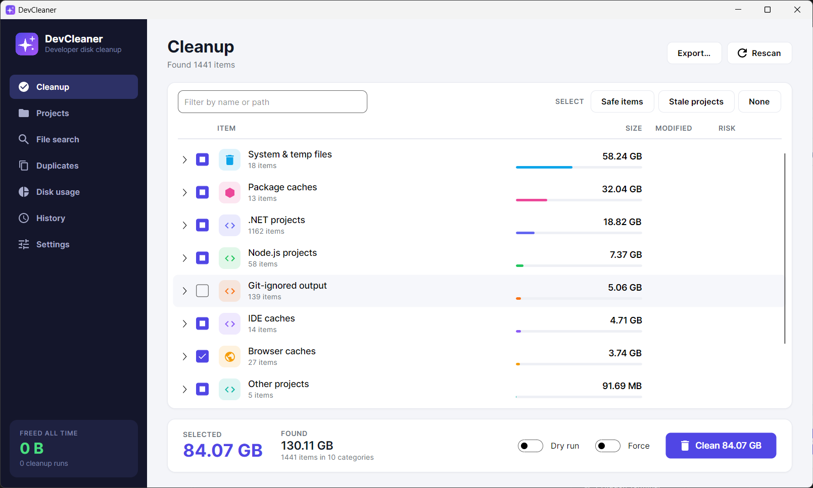
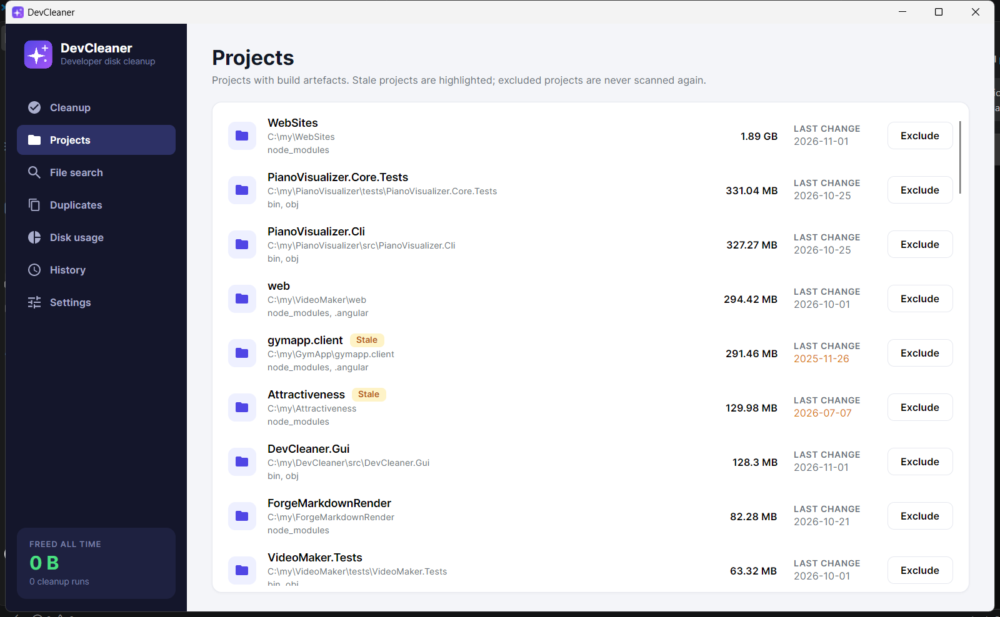
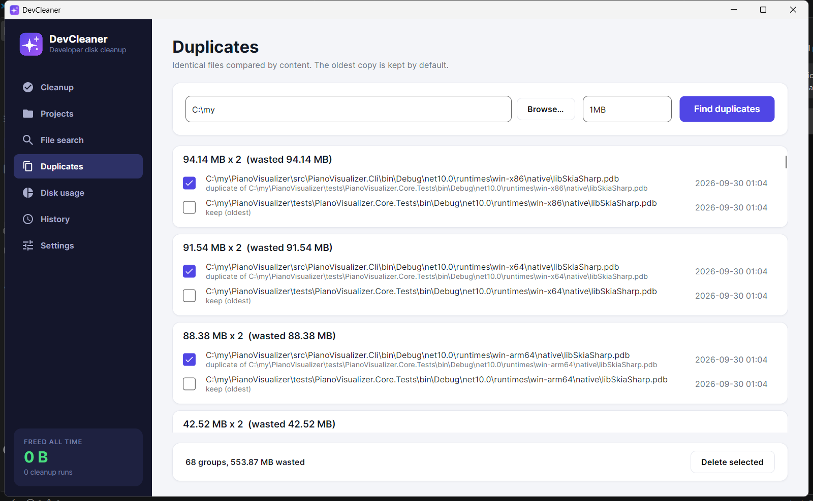
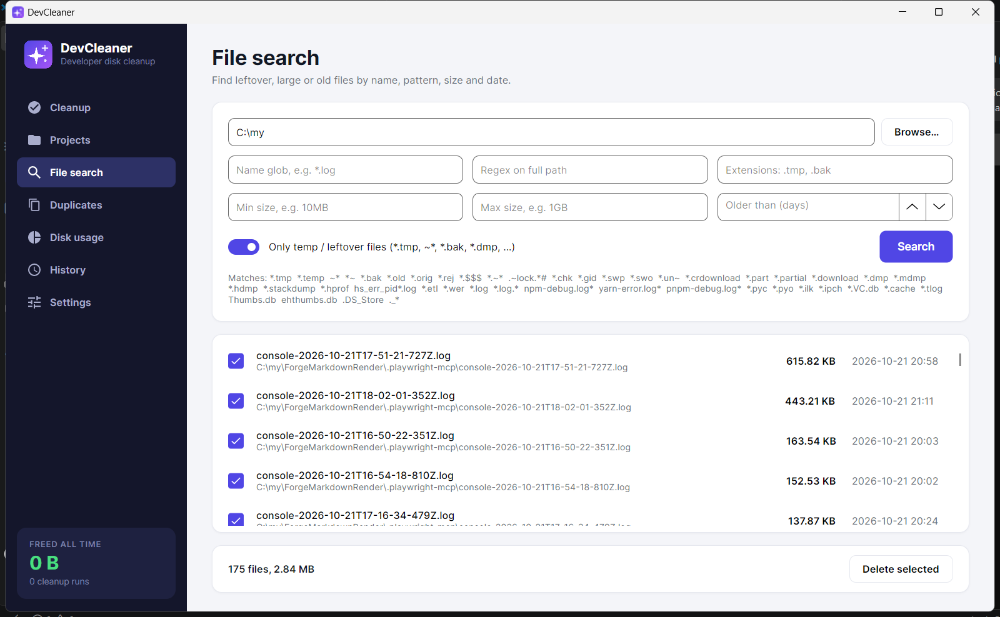
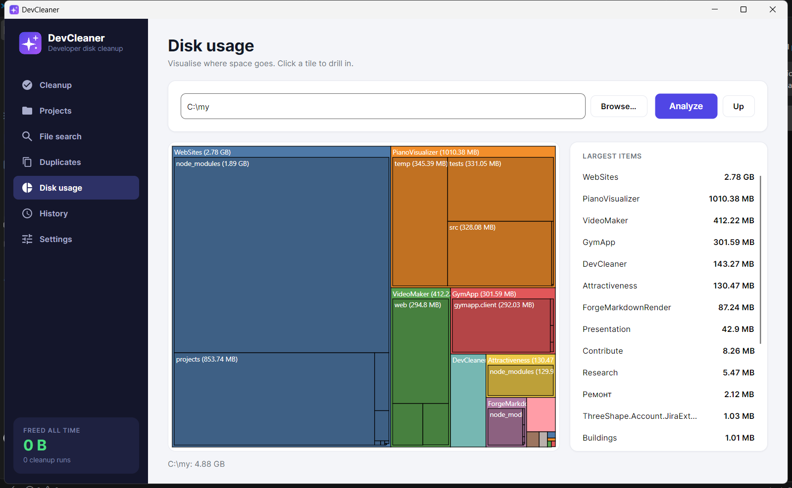
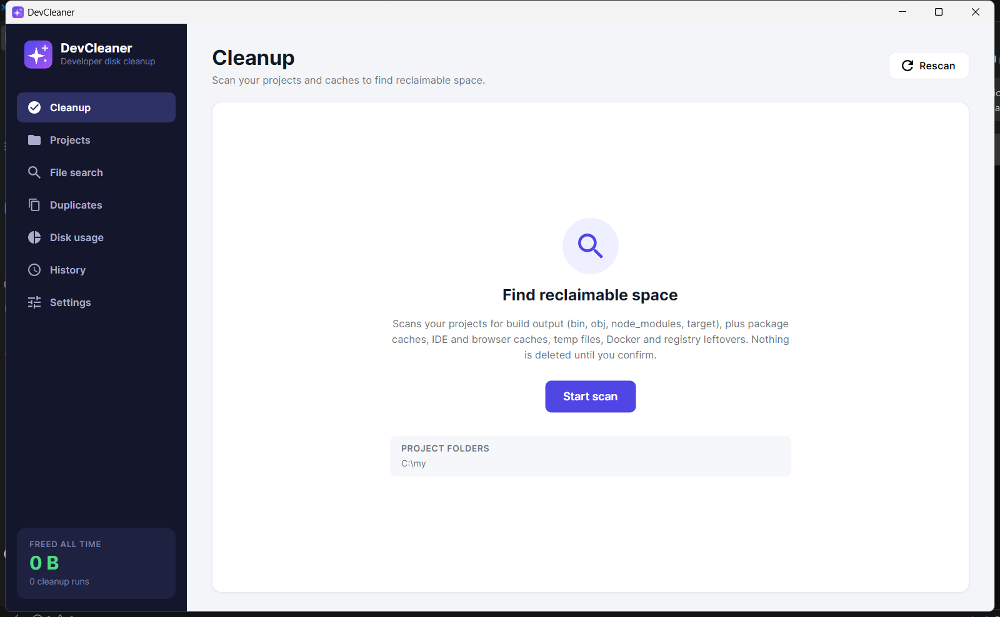
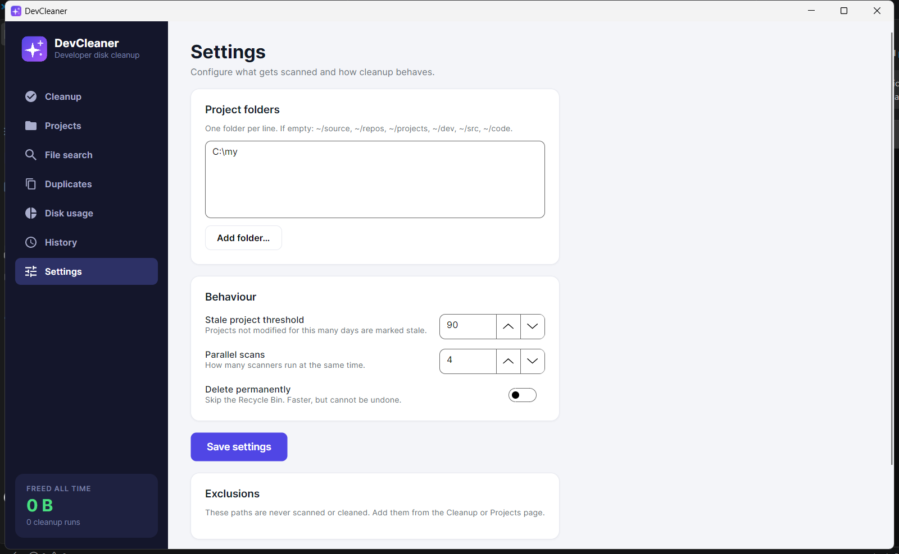

<p align="center">
  
</p>

<h1 align="center">DevCleaner</h1>

<p align="center">
  <b>Your SSD isn't small. Your <code>node_modules</code>, <code>bin/obj</code> and caches are just huge.</b><br/>
  Find and safely reclaim tens of gigabytes of developer junk in one click.
</p>

<p align="center">
  
  
  
  
</p>

<p align="center">
  
</p>

---

## Why?

Every developer knows the moment: **"Not enough disk space"** — in the middle of a build, a Docker pull, or an update.

It's rarely your code. It's everything around it:

| Where the space goes | Typical size |
|---|---|
| `node_modules` in old side projects | 200 MB – 2 GB **each** |
| `bin/` + `obj/` in every .NET project you ever cloned | 10 – 500 MB each |
| `%TEMP%` that nobody ever empties | 5 – 60 GB |
| NuGet / npm / pnpm / pip / Gradle / Maven caches | 5 – 30 GB |
| JetBrains / Visual Studio / VS Code caches | 1 – 10 GB |
| Docker images, dangling volumes, build cache | 10 – 100 GB |
| Browser caches across all profiles | 1 – 5 GB |

On the machine used for these screenshots DevCleaner found **130 GB** across 1,441 items on the first scan — 84 GB of it pre-selected as safe to clean.

## Features

- **One-click scan** of system temp, browser, IDE and package caches, project build output, Docker and the registry — grouped by category, with sizes.
- **Project-aware** — detects .NET, Node.js, Rust, Python, Gradle and Maven projects and shows each project's **last modification date**. Projects you haven't touched for 90 days are flagged as **stale**.
- **Git-aware** — inside any Git repo, folders matched by `.gitignore` are offered as build output (any language, via `git check-ignore`). Folders holding tracked files, IDE settings, `.env*`, `secrets/` etc. are never offered, and anything in a repo with **uncommitted changes** is raised to *Caution* with a warning. Requires `git` on `PATH`.
- **Exclude forever** — right-click any project or folder and it will never be scanned or cleaned again.
- **Safe by default** — choose **permanent delete** (GUI default) or the **Recycle Bin**, there's a **dry run** mode, and every item has a risk level (Safe / Review / Caution). Only *Safe* items are pre-selected.
- **Respects running apps** — browser and IDE caches are skipped while Chrome, Rider, VS Code etc. are running, and locked files are reported, not forced.
- **Advanced file search** — glob, regex, extensions, size and age filters, plus a 50+ pattern "leftover files" preset (`*.tmp`, `*.dmp`, `*.crdownload`, `hs_err_pid*.log`, `*.pyc`, ...).
- **Duplicate finder** — compares by content using a fast three-stage hash (size → 4 KB prefix → full xxHash64) and keeps the oldest copy.
- **Disk usage treemap** — see at a glance which folders are eating your drive and drill into them.
- **Lifetime statistics** — how much you've freed in total, by category, with a log of every cleanup run.
- **Custom rules** — add your own cleanup targets with a small JSON file. No recompiling.
- **Full CLI** — everything the GUI does, scriptable, with `--json` output.

## Screenshots

| Projects with last-change date and stale flag | Duplicate finder |
|---|---|
|  |  |

| Advanced file search | Disk usage treemap |
|---|---|
|  |  |

| First launch | Settings |
|---|---|
|  |  |

## What it cleans

| Category | Examples |
|---|---|
| **System & temp** | `%TEMP%`, `C:\Windows\Temp`, Windows Update download cache, thumbnail cache, DirectX shader cache |
| **Browsers** | Chrome, Edge, Brave, Opera, Firefox — cache, code cache and GPU cache only. **Never** cookies, history or passwords |
| **IDEs** | JetBrains caches and logs, Visual Studio ComponentModelCache, VS Code caches and logs, Xcode DerivedData and device support, iOS Simulator caches, Android Studio caches, Android SDK/build caches, Android emulator snapshots |
| **Package caches** | NuGet global packages and HTTP cache, npm, Yarn, pnpm, pip, Gradle, Maven, Cargo, Go build cache, `.dotnet/toolResolverCache`, Playwright and Cypress browser caches, WinGet and Homebrew download caches & logs, Bun, Deno, node-gyp, Electron, Poetry, uv, Composer, Cargo git checkouts, CocoaPods |
| **Projects** | `bin`, `obj`, `.vs`, `node_modules`, `.next`, `.nuxt`, `.turbo`, `.angular`, `target`, `__pycache__`, `.venv`, Gradle `build`, Unity `Library`/`Temp`, Unreal `Intermediate`/`DerivedDataCache`, Terraform `.terraform`, Flutter `.dart_tool`/`build`, SwiftPM `.build`, Elixir `_build`/`deps`, Zig caches, Haskell `.stack-work` |
| **Docker** | Unused images, stopped containers, unused volumes, build cache (via `docker system df` / `prune`) |
| **Registry** (Windows) | Recent-files lists and uninstall entries for software that's no longer installed. A `.reg` backup is written before every change |
| **Logs** | Crash dumps, Windows Error Reporting archives |

## Getting started

Requirements: [.NET 10 SDK](https://dotnet.microsoft.com/download).

```bash
git clone <this repo>
cd DevCleaner

# GUI
dotnet run --project src/DevCleaner.Gui

# CLI
dotnet run --project src/DevCleaner.Cli -- scan
```

Publish a single self-contained executable:

```bash
dotnet publish src/DevCleaner.Gui -c Release -r win-x64 --self-contained -p:PublishSingleFile=true
dotnet publish src/DevCleaner.Cli -c Release -r win-x64 --self-contained -p:PublishSingleFile=true
```

## CLI

```bash
devcleaner scan                                   # everything, grouped by category
devcleaner scan -c DotNetProjects NodeProjects --json
devcleaner clean --dry-run                        # preview, deletes nothing
devcleaner clean --max-risk Review --stale-only   # include node_modules etc. but only for stale projects
devcleaner clean -c Browsers --force --yes        # clean even while the browser is open, no prompt
devcleaner scan --export report.html             # export findings as HTML / CSV / JSON (by extension)
devcleaner clean --dry-run -o preview.csv         # export the clean result; --format overrides the extension

devcleaner search C:\work --temp-files --older-than-days 30
devcleaner search D:\ --min-size 1GB --ext .iso .zip
devcleaner dupes ~/Downloads ~/Documents --min-size 10MB
devcleaner usage C:\Users\me --depth 2

devcleaner roots add C:\work                      # where to look for projects
devcleaner roots stale-days 60
devcleaner exclude add C:\work\important-legacy-app --reason "keep build output"
devcleaner stats                                  # lifetime freed space by category
devcleaner history --details
devcleaner rules list
```

Exit codes: `0` success, `1` partial (some items skipped or failed), `2` error.

## Custom rules

Drop a JSON file into `%AppData%\DevCleaner\rules\` (`~/.config/DevCleaner/rules/` on Linux/macOS):

```jsonc
[
  // folders next to a marker file, anywhere under your project roots
  { "id": "unity-library", "name": "Unity Library", "category": "OtherProjects", "risk": "Safe",
    "markers": [ "ProjectVersion.txt" ], "targets": [ "Library", "Temp", "obj" ] },

  // fixed locations; supports {home}, {temp}, {appdata}, {localappdata}, %ENV% and * wildcards
  { "id": "android-avd-cache", "name": "Android emulator cache", "category": "Custom", "risk": "Review",
    "paths": [ "{home}/.android/avd/*.avd/cache" ], "contentsOnly": true, "processes": [ "qemu-system-x86_64" ] }
]
```

Check a rule file with `devcleaner rules validate my-rules.json`. All built-in rules live in [builtin-rules.json](src/DevCleaner.Core/Rules/builtin-rules.json) and use the same format, so they're a good place to start.

## Safety

DevCleaner deletes files, so it takes that seriously:

- GUI deletes permanently by default (uncheck **Delete permanently** for Recycle Bin); CLI uses the Recycle Bin unless `--permanent`.
- Hard-coded guard: never deletes a drive root, your user profile, `Windows`, `Program Files`, AppData roots, `.ssh`, or any parent of them.
- Custom-rule targets can't contain `..` or path separators.
- Symlinks and junctions are never followed.
- Registry keys are exported to `.reg` before deletion, and only two well-defined key families are touched.
- Locked files are skipped and reported instead of forcing anything.
- Git-ignored folders are only offered when the folder itself matches an ignore rule and contains no tracked files; repos with uncommitted changes are flagged *Caution*.

## Architecture

```
src/
  DevCleaner.Core               scan & clean engines, rules, providers, search, duplicates, disk usage (no OS APIs)
  DevCleaner.Platform.Windows   Recycle Bin, Restart Manager lock detection, registry provider
  DevCleaner.Platform.Unix      Linux/macOS placeholder
  DevCleaner.Infrastructure     JSON settings/exclusions/stats/history + composition root
  DevCleaner.Gui                Avalonia desktop app (MVVM)
  DevCleaner.Cli                System.CommandLine + Spectre.Console
tests/
  DevCleaner.Tests              xUnit
```

Everything OS-specific sits behind `IPlatformServices`, and every cleanup source is an `ICleanupProvider`. Adding Linux/macOS support means implementing one small platform project — the engines, rules, GUI and CLI stay the same.

## Roadmap

- [ ] Linux & macOS trash support
- [ ] Scheduled cleanups
- [x] Export reports (JSON / CSV / HTML)
- [x] Android SDK / emulator, Xcode DerivedData, Unity and Unreal rules out of the box
- [x] Winget / Homebrew packages

## Contributing

Issues and PRs are welcome — new cleanup rules especially. Run `dotnet test` before submitting.

## License

DevCleaner is source-available under the [DevCleaner Personal Use License](LICENSE):

- ✅ Free for **personal, non-commercial** use by individuals.
- ✅ Contributions via issues and pull requests are welcome.
- ❌ No commercial, enterprise, or organizational use without a separate license.
- ❌ No forks, redistribution, or derivative versions
